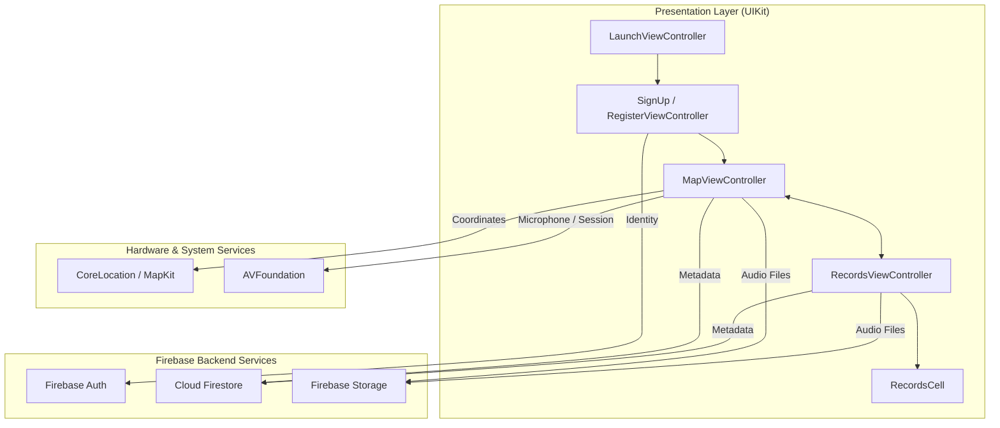

<div align="center">

  

  # 🗺️ SoundMap for iOS

  **An acoustic memory atlas that geotags your voice recordings directly onto an interactive map.**

  [](https://swift.org)
  [](https://developer.apple.com/ios/)
  [](https://developer.apple.com/documentation/uikit)
  [](https://developer.apple.com/documentation/mapkit)
  [](https://developer.apple.com/documentation/avfoundation)
  [](https://firebase.google.com)
  [](#-license--copyright)

  [Overview](#-overview) •
  [Key Features](#-key-features) •
  [Architecture & Data Flow](#-architecture--data-flow) •
  [Tech Stack](#-tech-stack) •
  [Setup Guide](#-setup--configuration) •
  [Permissions](#-privacy--permissions)

</div>

---

## 📖 Overview

**SoundMap** transforms geographical exploration into a personalized acoustic diary. Rather than documenting your travels or daily reflections purely through text or photos, SoundMap captures the authentic atmosphere of any moment through high-fidelity voice notes pinned precisely to real-world coordinates.

Whether saving field recordings from a hiking trail, capturing street soundscapes during travel, or preserving vocal reflections at meaningful landmarks, SoundMap lets you revisit your memories both visually and acoustically.

---

## ✨ Key Features

### 📍 Interactive Geotagged Map
- **Live Location Tracking:** Integrates `CoreLocation` (`CLLocationManager`) to automatically detect the user's position with high-accuracy GPS.
- **Custom Map Annotations:** Geotag audio clips with interactive MapKit pins (`MKPointAnnotation`).
- **Coordinate Selector:** Drop pins at your current location or select any point on the map to pin historical memories.

### 🎙️ Audio Recording & Playback Engine
- **Hardware-Optimized Audio Pipeline:** Powered by `AVFoundation` (`AVAudioRecorder` and `AVAudioSession`).
- **Instant Local Playback:** Streamline field playback with `AVAudioPlayer` before committing recordings to the cloud.
- **Interactive Audio Controls:** Dynamic record, stop, and play triggers with stateful UI button updates.

### ☁️ Cloud Sync & Storage
- **Firebase Storage Integration:** Asynchronous binary upload of voice tracks with secure remote URL generation.
- **Cloud Firestore Metadata:** Coordinates (latitude, longitude), timestamps, titles, and ownership metadata indexed per authenticated user.
- **Firebase Authentication:** Secure email/password login and account registration flows.

### 📂 Audio Journal & Gallery (Records View)
- **Personal Audio Catalog:** Custom `UITableView` listing all saved voice memories.
- **In-List Playback:** Stream and listen to saved cloud recordings directly within the list interface.
- **Fast Navigation:** Floating action shortcuts seamlessly transitioning between map canvas and recordings archive.

---

## 🏛️ Architecture & Data Flow

The project follows a clean native **Model-View-Controller (MVC)** architectural pattern, decoupled across dedicated managers for location, audio sessions, and cloud synchronization:



---

## 📂 Project Structure

```
SoundMap/
├── SoundMap/
│   ├── ViewControllers/
│   │   ├── LaunchViewController.swift     # Splash & initial authentication routing
│   │   ├── SignUpViewController.swift       # User registration screen
│   │   ├── RegisterViewController.swift     # Login & credential verification
│   │   ├── MapViewController.swift          # Core map canvas, location pins & recorder UI
│   │   ├── RecordsViewController.swift      # Saved audio list with inline audio player
│   │   └── OnboardingViewController.swift   # First-run welcome experience
│   ├── Cell/
│   │   └── RecordsCell.swift                # Custom table view cell for audio records
│   ├── Storyboards/
│   │   ├── Main.storyboard                  # Navigation, Map & Records UI flow
│   │   └── Launch Screen.storyboard         # Native iOS launch screen
│   ├── SoundMap.xcdatamodeld/               # CoreData entity definitions for local storage
│   ├── Assets.xcassets/                     # App icons, vectors, and audio illustration assets
│   ├── AppDelegate.swift                    # Firebase configuration & app lifecycle
│   ├── SceneDelegate.swift                  # Multi-window scene setup
│   └── Info.plist                           # System privacy usage descriptions
└── SoundMap.xcodeproj                       # Xcode project workspace configuration
```

---

## 🛠️ Tech Stack

| Domain | Technology / Framework | Usage |
|---|---|---|
| **Language** | [Swift 5.9](https://swift.org) | Modern, type-safe native iOS programming |
| **User Interface** | [UIKit](https://developer.apple.com/documentation/uikit) | Auto Layout, Storyboards, Programmatic View Hierarchy |
| **Maps & Geolocation** | [MapKit](https://developer.apple.com/documentation/mapkit) & [CoreLocation](https://developer.apple.com/documentation/corelocation) | Vector maps, custom pins (`MKAnnotation`), coordinate math |
| **Audio Processing** | [AVFoundation](https://developer.apple.com/documentation/avfoundation) | `AVAudioRecorder`, `AVAudioPlayer`, `AVAudioSession` |
| **Authentication** | [Firebase Auth](https://firebase.google.com/docs/auth) | User signup, session management, and credential storage |
| **Database** | [Cloud Firestore](https://firebase.google.com/docs/firestore) | Real-time NoSQL metadata storage for coordinate-bound notes |
| **Media Storage** | [Firebase Storage](https://firebase.google.com/docs/storage) | Cloud audio file hosting with secure download URLs |
| **Local Persistence** | [CoreData](https://developer.apple.com/documentation/coredata) | Local schema caching for offline stability |

---

## ⚙️ Setup & Configuration

### Prerequisites
- macOS Sonoma or later
- [Xcode 15.0+](https://developer.apple.com/xcode/)
- Active [Firebase](https://firebase.google.com/) account

### 1. Clone & Open
```bash
git clone https://github.com/sahinsanli/Soundmap.git
cd Soundmap
open SoundMap/SoundMap.xcodeproj
```

### 2. Configure Firebase
1. Navigate to the [Firebase Console](https://console.firebase.google.com/) and create a project.
2. Add an **iOS App** matching your bundle identifier (e.g. `com.sahinsanli.SoundMap`).
3. Download the generated `GoogleService-Info.plist`.
4. Drag and drop `GoogleService-Info.plist` into the `SoundMap/SoundMap` directory inside Xcode (check *Copy items if needed*).
5. Enable **Email/Password** authentication under *Firebase Auth*.
6. Enable **Cloud Firestore** and **Firebase Storage** with standard authenticated security rules:
   ```javascript
   rules_version = '2';
   service firebase.storage {
     match /b/{bucket}/o {
       match /audio/{userId}/{allPaths=**} {
         allow read, write: if request.auth != null && request.auth.uid == userId;
       }
     }
   }
   ```

---

## 🔒 Privacy & Permissions

SoundMap strictly adheres to Apple's privacy guidelines by declaring explicit usage descriptions inside `Info.plist`:

| Permission Key | Description |
|---|---|
| `NSLocationWhenInUseUsageDescription` | Required to detect real-time GPS coordinates and pin audio recordings on the map. |
| `NSMicrophoneUsageDescription` | Required to capture high-fidelity voice notes and environmental ambient sounds. |

---

## 📄 License & Copyright

**Copyright © 2026 Şahin Şanlı. All Rights Reserved.**

This repository and its source code are published **strictly for personal portfolio demonstration and technical showcase purposes**. 

Unauthorized copying, modification, distribution, reverse engineering, or commercial reproduction of this software or its branding assets is strictly prohibited without explicit written permission from the copyright holder.

---

<div align="center">
  <sub>Crafted with precision by <a href="https://github.com/sahinsanli">Şahin Şanlı</a>.</sub>
</div>
